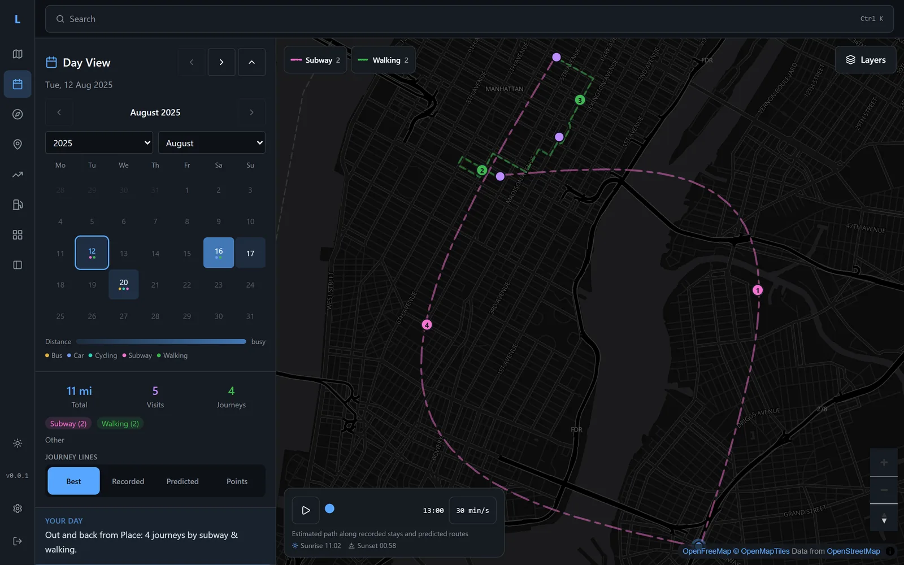
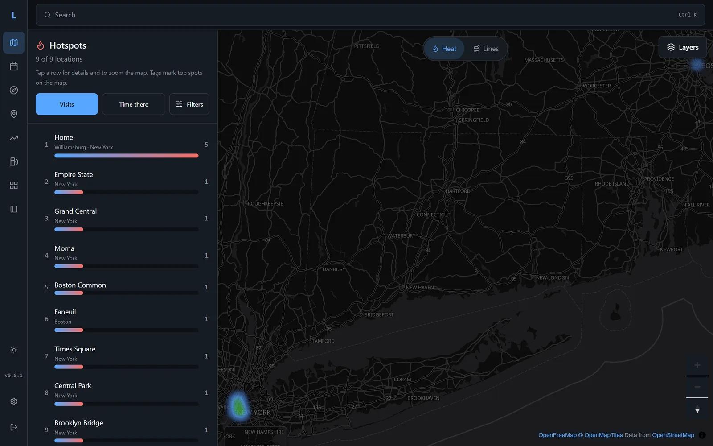
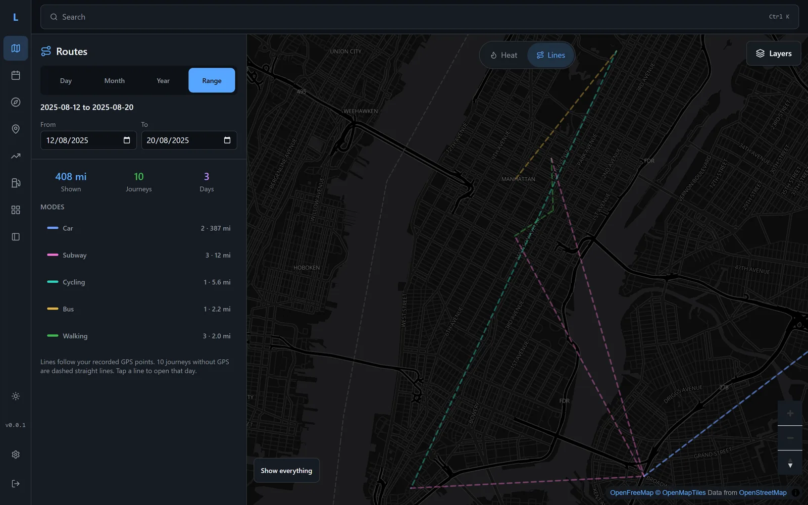
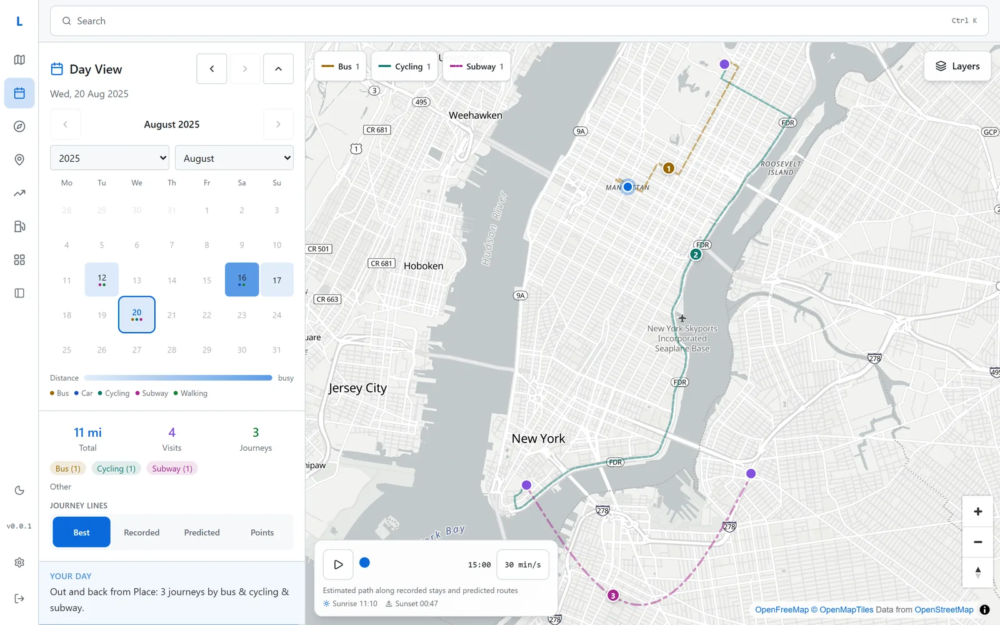
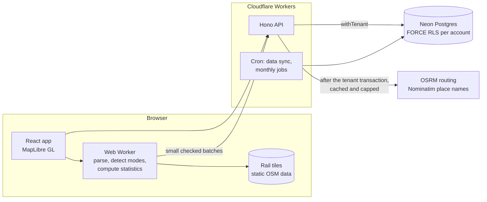

<div align="center">

# Locations

**Your Google Timeline as a private map journal.**
Heatmaps of where you spend your time, every journey drawn from your own GPS points, trains spotted even when Google called them drives, and insights for any period.

[](https://github.com/Arbzy1/locations/actions/workflows/ci.yml)
[](LICENSE)


[**Try the live demo**](https://locations.aden.website) · [Features](docs/product/features.md) · [Architecture](docs/architecture/overview.md) · [Self-host](#self-host)



</div>

> Screenshots use the built-in demo data (a few days of New York and Boston landmarks). Click **Try the demo** on the live site to explore it yourself; your own data stays private to your account.

## What it does

| | |
|---|---|
|  |  |
| **Hotspots.** A heatmap of where you spend time, with every spot named after the real place: Home, Work, the street or building, or your own name for it. | **Routes.** Every journey for a day, month, year or any range, coloured by transport, with mileage per mode. |
|  | |
| **Day View.** One day on a map with its timeline. Journeys follow your recorded GPS points, matched to roads or the railway, numbered and coloured by mode, with faint dashes where the GPS went quiet. | **And more.** Insights for any period against the same dates last year, On this day, trips, a place directory, GPX and GeoJSON export, and Journey cost: UK trip cost for fuel or charging, tolls and clean-air zones. |

### Highlights

- **Trains detected from GPS.** Google often labels a train ride as driving. Locations checks each journey's GPS points against OpenStreetMap railway lines (Great Britain and Ireland) and its speed, relabels it, and draws it along the actual tracks. One tap undoes it.
- **Honest lines.** A route is only drawn on roads when it stays with your GPS points; otherwise you see the points themselves. Impossible start or end points from Google are ignored, and long gaps are drawn as a guess.
- **Imports of any size on a free plan.** Your browser parses the export and works out the statistics in a Web Worker; the server only stores small checked batches.
- **Private by design.** Every table is isolated per account by the app and by Postgres row-level security. Coordinates and place names never go into logs or emails. Delete your account and everything goes with it.
- **Dark and light, desktop and phone.** Built with shadcn/ui and Motion, with a bottom-sheet layout on phones.

## How it works



The Worker runs within Cloudflare's free plan (10 ms of CPU and 50 outbound requests per request), so heavy work happens in the browser and every API route is a handful of database statements. More in [docs/architecture](docs/architecture/overview.md).

| Layer | Tech |
|-------|------|
| Edge | Cloudflare Workers and static assets (Wrangler) |
| API | [Hono](https://hono.dev) |
| Auth | [Better Auth](https://better-auth.com): email and password, magic links, codes, optional Google |
| Database | [Neon](https://neon.tech) Postgres, [Drizzle ORM](https://orm.drizzle.team), FORCE row-level security |
| UI | React 19, Vite, Tailwind 4, shadcn/ui, Motion, MapLibre GL, Recharts |
| Billing | Stripe Checkout and Customer Portal (optional) |

## Self-host

**You need** Node 20+, a [Neon](https://neon.tech) Postgres database, and optionally a Cloudflare account (to deploy), Resend (email), Stripe (billing) and commercial map tiles or routing.

```bash
git clone https://github.com/Arbzy1/locations.git
cd locations
npm install
npm run setup:project   # interactive: database, sample import, first admin user
npm run dev:all         # app on http://localhost:5173, API on http://localhost:8787
```

**Get your data:** export your Timeline from Google Maps on your phone, or **Location History** from [Google Takeout](https://takeout.google.com/), then upload the JSON file or zip in Settings ([supported files](docs/product/takeout-import.md)). Keep real exports outside git.

**Deploy:** staging and production are named Wrangler environments. Database migrations are a separate step from deploys. See [docs/engineering/deploy.md](docs/engineering/deploy.md).

<details>
<summary><b>Useful scripts</b></summary>

| Script | Purpose |
|--------|---------|
| `npm run dev:all` | Vite with hot reload and Wrangler, together |
| `npm run dev:e2e` | Production build served by Wrangler (OAuth, Stripe, Playwright) |
| `npm run dev:kill` | Free leftover dev-server ports |
| `npm run typecheck:all` | TypeScript across every workspace |
| `npm run test:unit` / `test:integration` / `test:security` | Vitest projects and the security catalog |
| `npm run test:e2e` | Playwright against `dev:e2e` |
| `npm run db:migrate:dev` / `db:migrate:prod` | Apply the schema |
| `npm run db:import` | Import a Timeline file from the command line |
| `npm run rail:build` | Rebuild the UK and Ireland rail tiles from OpenStreetMap |
| `npm run release` | Tag a release and promote the changelog |

</details>

## Project layout

```
apps/web/        React app (Vite, Tailwind, shadcn/ui, MapLibre)
apps/api/        Cloudflare Worker (Hono)
packages/db/     Schema, migrations, Timeline parsing, statistics, mode detection
packages/brim/   Journey cost engine and UK reference data
docs/            Product, architecture, security, engineering and legal docs
tests/           Every test lives here (unit, integration, RLS, e2e)
```

## Documentation

- [Features](docs/product/features.md) and [changelog](docs/changelog.md)
- [Architecture](docs/architecture/overview.md): [import pipeline](docs/architecture/import-pipeline.md), [maps and routing](docs/architecture/maps-and-routing.md), [tenancy and RLS](docs/architecture/tenancy-and-rls.md), [Journey cost](docs/architecture/journey-cost.md)
- [API routes](docs/api/routes.md)
- [Security](docs/security/README.md) and [reporting a vulnerability](docs/SECURITY.md)
- [Local setup](docs/engineering/local-setup.md), [testing](docs/engineering/testing.md), [deploy](docs/engineering/deploy.md), [roadmap](docs/engineering/roadmap.md)

## Contributing

Issues and pull requests are welcome. See [CONTRIBUTING.md](CONTRIBUTING.md) for the short version of the house rules; `AGENTS.md` has the full set used by AI coding tools too.

## Credits and license

Map data © [OpenStreetMap](https://www.openstreetmap.org/copyright) contributors, rail tiles under the ODbL ([credits](docs/legal/credits.md)). Basemap by [OpenFreeMap](https://openfreemap.org). Routing by [OSRM](https://project-osrm.org), place names by [Nominatim](https://nominatim.org).

Released under the [MIT License](LICENSE).
